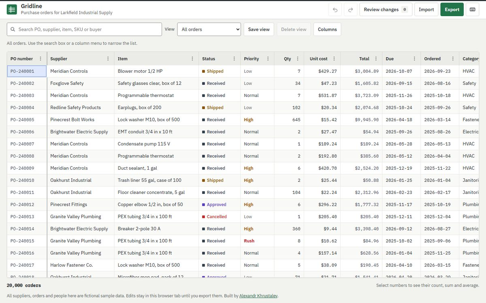

# Gridline

Gridline is an editable data grid for operations teams. It loads 20,000 purchase orders for Larkfield Industrial Supply, a fictional distributor, and lets a buyer filter, sort, edit, paste, undo and review every change before exporting it.

It is a single static page written as plain ES modules. There is no framework, no bundler and no build step, so it runs from GitHub Pages or any static file server.

All suppliers, orders, buyers and figures are fictional sample data, generated from a fixed seed so every visit sees the same 20,000 rows.



## What you can do

**Work with a large table**
- Scroll 20,000 rows smoothly. Only the rows on screen, about 30 to 40, are in the DOM, and the active row is always kept rendered for screen readers.
- 15 columns of mixed types: PO number, supplier, item, status, priority, quantity, unit cost, a computed total, due and order dates, category, warehouse, SKU, buyer and notes.

**Find the right rows**
- Sort by any column. Click a header to sort, click again to reverse, Shift and click to add a second or third sort key. Status and priority sort in workflow order, not alphabetically.
- Filter each column from its menu: contains text, number range, date range or a multi-select list with counts.
- Search every text column at once. Several words must all match.
- See every active filter, the search and the sort as chips above the grid, and remove any of them with one click.
- Save the current filters, sort, search and column layout as a named view. Four built-in views cover all orders, open orders past their due date, rush and high priority orders, and the largest open orders.

**Edit safely**
- Edit in place with Enter, F2, a double click or by typing. Each column checks its own type: whole numbers, money with at most two decimals, real calendar dates, a fixed list of statuses, required text and a SKU pattern.
- The due date can't be earlier than the order date, and the check sees other edits to the same row in the same paste.
- An invalid edit stays open with the reason under it and is never saved.
- Select a range with the mouse or Shift and the arrow keys, copy it as tab separated text, paste a block from a spreadsheet, or fill the top row down. Invalid pasted cells are skipped and listed with the reason, the rest are applied.
- Undo and redo every edit. A paste, a fill, an import and a revert are each one step.
- Edited cells are highlighted and show their old value on hover.
- Review changes lists every edited cell with the PO number, column, old value and new value. Revert one change or all of them, and undo the revert if needed.

**Move data in and out**
- Import a CSV with comma or semicolon separators. Columns are matched to the grid by name and common aliases such as Quantity or Unit price, and each match can be changed. Rows are matched by PO number. A row with any bad value is rejected as a whole, and the report lists the line number, PO number and reason. A sample import file with four deliberate problems is built in.
- Export the current view with its filters, sort and visible columns, or export only the changes with old and new values. Text that a spreadsheet would run as a formula is escaped.

**Arrange the grid**
- Resize columns by dragging the header edge, reorder by dragging a header, hide columns and pin columns to the left. The column menu and the Columns panel offer the same actions as buttons.

**Read the numbers**
- The footer shows the count, sum and average of every numeric column in the selected range.

**Use it anywhere**
- Full keyboard navigation following the ARIA grid pattern: one tab stop, arrow keys, Home and End, Page Up and Page Down, Ctrl with arrows to jump, and the header row is reachable for sorting.
- Under 640 pixels wide the grid becomes a list of order cards. Tap a card to edit the order in a form with the same validation. Filters and sort move into a sheet and a menu.
- No horizontal page scroll at 320, 390, 768 or 1440 pixels.

## Run it

Any static server works. With Node 22 or newer, which the test command also needs:

```
node checks/serve.mjs . 8931
```

Then open http://127.0.0.1:8931/. To publish, copy the folder to a GitHub Pages branch. Every path is relative.

## Files

- `index.html` and `styles.css` hold the page and its design: cool grey and slate with one working blue, IBM Plex Sans for the interface and IBM Plex Mono for figures, IDs and dates.
- `src/core.mjs` holds the pure logic: the seeded data generator, the column schema, parsing and validation, filters, search, multi-column sort, the undo history, CSV and TSV parsing and writing, import column matching and range statistics.
- `src/model.mjs` holds the edit model: batch validation, dirty tracking against original values, undo and redo, revert and the import plan. It has no DOM access either.
- `src/app.mjs` is the interface: the virtualized grid, keyboard and mouse handling, menus, dialogs and the phone cards.
- `tests/` holds the unit tests. `checks/` holds the browser flow check, the screenshot and overflow check, the cover builder and a benchmark.

## Tests and checks

| Check | Command | Result |
| --- | --- | --- |
| Unit tests for core and model | `node --test tests/*.test.mjs` | 54 of 54 pass, 39 core and 15 model |
| Browser flow in headless Brave | `node checks/flow.mjs` | 128 of 128 checks pass |
| Overflow and console errors at 320, 390, 768 and 1440 | `node checks/shots.mjs` | No horizontal overflow, no console errors |

The flow check drives the real page through the Chrome DevTools Protocol. It covers loading and virtualization, keyboard navigation, header sorting, all four filter kinds, chips, search, editing with valid and invalid values, the date rule, mouse drag selection, Shift and click, double-click editing, undo and redo, range selection and the footer summary, copy, paste, fill down, Delete on a required cell, the review panel with single and full revert, both CSV exports, CSV import with the error report, pin, hide, resize, reorder, saved views across a reload, blocked storage, the phone cards with their editor, filters and sort, and a final check for console errors. Filter results are compared with counts computed independently from a fresh copy of the data.

## Performance

Measured on the development PC with `node checks/flow.mjs` in headless Brave at 1440 by 900 with the GPU disabled, and with `node checks/bench.mjs` in Node 24. The numbers are from one run and will vary by machine.

| Measure | Result |
| --- | --- |
| Scrolling 180 pixels every frame for 3 seconds | 60.7 frames per second, slowest frame 16.8 ms, 41 rows in the DOM |
| Search across 20,000 rows, from Enter to the next painted frame | 16.9 to 22.4 ms over five runs, of which 7.6 to 12.8 ms is the search itself |
| Sort 20,000 rows by Total, from click to the next painted frame | 14.3 to 15.0 ms over five runs, of which 4.6 to 5.0 ms is the sort |
| Status and quantity filters plus a search over 20,000 rows, in the page | 0.5 ms |
| Generate 20,000 rows, in Node | 26 ms |
| Sort by supplier then due date, in Node | 6.8 ms |
| Validate and apply a bulk edit of 20,000 cells, in Node | 11.7 ms |
| Undo that edit, in Node | 6.5 ms |
| Export 20,000 rows to a 3.1 MB CSV, in Node | 26.5 ms |
| Parse that CSV back, in Node | 31.1 ms |

Headless frame timing follows a 60 Hz frame clock, so 60 frames per second means no frame was dropped. It does not prove the same result on a slow phone.

## Known limits

- Edits live in memory in the browser tab. There is no server and nothing is saved except named views.
- Columns are not virtualized. All 15 are rendered for each visible row, which is cheap at this width.
- Adding or deleting rows is not supported. Import updates existing orders by PO number.
- Edited rows keep their place until you refresh the view, so a row does not jump away while you edit it. A chip offers the refresh when an edit touches a sorted or filtered column.
